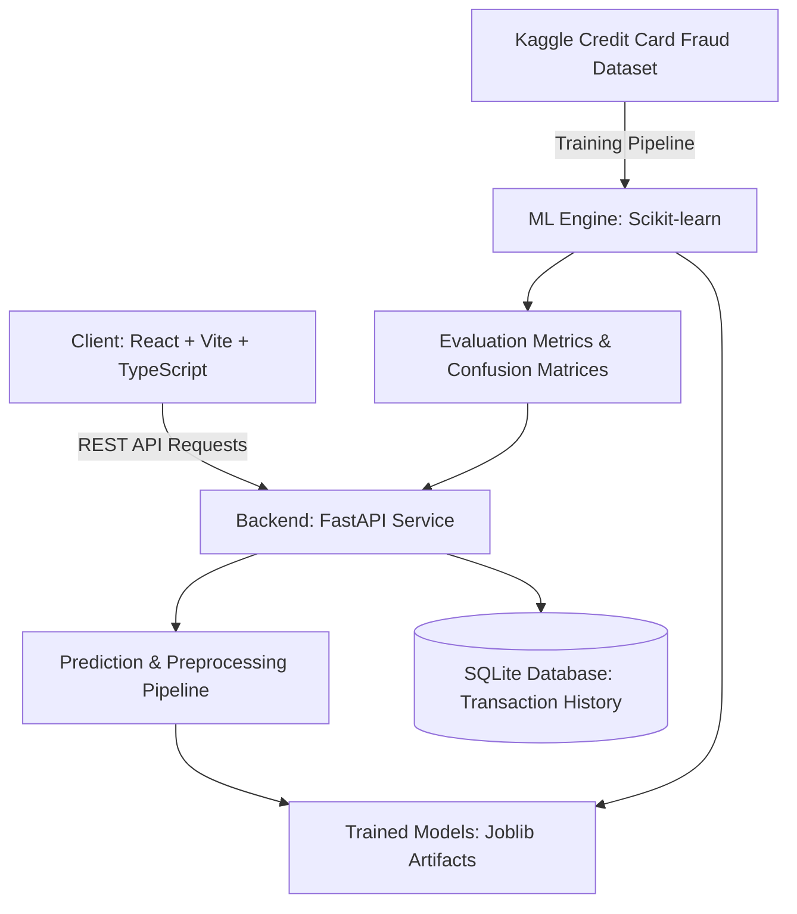

# FraudShield — Credit Card Fraud Detection Using Machine Learning

[](https://www.python.org/)
[](https://fastapi.tiangolo.com/)
[](https://reactjs.org/)
[](https://vitejs.dev/)
[](https://tailwindcss.com/)
[](LICENSE)

An academic mini-project and enterprise-grade financial risk analytics web application designed to detect, analyze, and monitor fraudulent credit card transactions using machine learning.

---

## 📌 Executive Summary

Credit card fraud presents immense challenges to financial institutions worldwide. Due to extreme class imbalance (typically less than 0.2% of transactions are fraudulent) and evolving attacker patterns, standard machine learning techniques that optimize purely for accuracy fail. 

**FraudShield** demonstrates an end-to-end machine learning engineering and full-stack implementation:
- **ML Pipeline**: Implements stratified preprocessing, class-weight balancing, and comparative evaluation between **Logistic Regression** (interpretable baseline) and **Random Forest** (ensemble classifier).
- **Evaluation**: Emphasizes Recall, Precision, F1-Score, ROC-AUC, and Precision-Recall (PR) AUC rather than misleading raw accuracy.
- **RESTful API**: High-performance FastAPI backend with strict Pydantic schemas, SQLite persistence, and CORS protection.
- **Fintech Dashboard**: Restrained, enterprise-grade React & TypeScript interface with Recharts visualizations, single-transaction scoring, batch CSV processing, and a searchable transaction explorer.
- **Academic Documentation**: Complete project report documentation suitable for university degree evaluation.

---

## 🏛 System Architecture



---

## 🚀 Key Features

1. **Financial Risk Analytics Dashboard**:
   - High-level KPIs: Total transactions analyzed, verified model recall and precision, anomaly distribution, and volume trends.
   - Live application metrics versus static dataset evaluation metrics clearly distinguished.

2. **Single Transaction Risk Scoring**:
   - Complete PCA feature schema support (V1–V28, Time, Amount).
   - Probabilistic fraud score output with risk tier classification (Low, Medium, High).
   - Transparent feature inspection and probabilistic disclaimers.

3. **Batch Transaction Analysis**:
   - Drag-and-drop CSV batch upload with schema validation and row-level checks.
   - Asynchronous batch inference with progress indication.
   - Export enriched prediction results with fraud risk scores and timestamps to CSV.

4. **Transaction Explorer & Audit Trail**:
   - Persistent SQLite transaction storage.
   - Search by transaction ID, filter by risk classification, and pagination.
   - Detailed inspection drawer for transaction feature attributes.

5. **Model Evaluation & Benchmarking**:
   - Side-by-side performance comparison: **Logistic Regression** vs **Random Forest**.
   - Confusion matrices, ROC curves, and Precision-Recall curves computed from held-out test splits.
   - Threshold trade-off analysis for fraud detection costs vs false positive friction.

6. **Dataset & Academic Documentation**:
   - Dataset schema definitions, class imbalance analysis, and sample CSV downloads.
   - 20-chapter academic project report draft in `docs/` for college submission.

---

## 🛠 Technology Stack

### Frontend
- **Framework**: React 18 with TypeScript
- **Bundler**: Vite
- **Styling**: Tailwind CSS (Enterprise Fintech Palette: `#F5F7FA` bg, `#172033` text, `#2457C5` primary accent, `#C83E4D` fraud danger)
- **Visualizations**: Recharts
- **Icons**: Lucide React
- **Routing**: React Router v6

### Backend & Machine Learning
- **API Engine**: FastAPI (Python 3.11+)
- **Validation**: Pydantic v2
- **Data Manipulation**: Pandas, NumPy
- **Machine Learning**: Scikit-Learn
- **Serialization**: Joblib
- **Database**: SQLite (via SQLAlchemy or standard DB-API)

---

## 📂 Project Structure

```
FraudShield/
├── backend/
│   ├── app/
│   │   ├── api/             # FastAPI endpoints (predict, batch, transactions, metrics)
│   │   ├── core/            # Configuration, logging, and security
│   │   ├── database/        # SQLite connection, models, and repositories
│   │   ├── schemas/         # Pydantic request and response schemas
│   │   ├── services/        # Prediction engine and business logic
│   │   └── main.py          # FastAPI application entrypoint
│   ├── ml/
│   │   ├── train.py         # Pipeline training script (LR & RF)
│   │   ├── evaluate.py      # Test-split evaluation and metric generator
│   │   ├── predict.py       # Inference wrapper and probability calibrator
│   │   └── preprocessing.py # Feature scaling and pipeline transforms
│   ├── data/                # Dataset placeholder and sample files
│   ├── models/              # Serialized model artifacts (.joblib) and metrics (.json)
│   ├── tests/               # Backend unit and integration tests
│   └── requirements.txt     # Pinned Python dependencies
├── frontend/
│   ├── src/
│   │   ├── components/      # Reusable UI widgets, tables, metrics, and navigation
│   │   ├── pages/           # Dashboard, Single Predict, Batch, Explorer, Metrics, Docs
│   │   ├── services/        # Axios / Fetch API client
│   │   ├── types/           # TypeScript interfaces matching backend schemas
│   │   ├── App.tsx          # Router layout and navigation
│   │   └── index.css        # Tailwind styles & theme variables
│   ├── package.json
│   ├── tsconfig.json
│   └── vite.config.ts
├── docs/                    # Complete academic mini-project documentation
├── README.md
└── .gitignore
```

---

## ⚡ Getting Started

### 1. Prerequisites
- **Python 3.11+** installed
- **Node.js 18+** & **npm** installed
- Git

### 2. Backend Setup
```bash
cd backend
python -m venv venv

# Windows
venv\Scripts\activate
# Linux/macOS
source venv/bin/activate

pip install -r requirements.txt

# Train baseline models on synthetic or imported dataset
python ml/train.py

# Start FastAPI server
uvicorn app.main:app --reload --port 8000
```
API Documentation will be live at `http://localhost:8000/docs`.

### 3. Frontend Setup
```bash
cd frontend
npm install
npm run dev
```
Open `http://localhost:5173` in your browser.

---

## 📊 Dataset Information

This project is tailored for the benchmark **Credit Card Fraud Detection Dataset** (originally collected by Worldline and the Machine Learning Group at ULB):
- **Features**: `V1`–`V28` (principal components obtained via PCA due to confidentiality), `Time` (seconds elapsed since first transaction), `Amount` (transaction amount in currency).
- **Target**: `Class` (1 for fraudulent transaction, 0 otherwise).

Instructions for placing the dataset in `backend/data/creditcard.csv` or generating reproducible synthetic research samples are included in the repository.

---

## 📄 License & Academic Disclaimer

This project is developed for educational and academic research purposes. Model predictions represent probabilistic risk estimations and should be utilized as decision-support signals rather than autonomous financial decisions.
